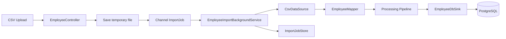

# HRMS

A small Human Resources Management System backend built with ASP.NET Core.

The project provides basic employee management and asynchronous CSV import. Imported employees are validated, transformed through the custom `DataPipeline` library, and persisted to PostgreSQL.

The application is designed as a portfolio project demonstrating ASP.NET Core, Entity Framework Core, PostgreSQL, background processing, Docker, and reusable package integration.

## Features

- ASP.NET Core Web API
- Employee CRUD operations
- PostgreSQL persistence with Entity Framework Core
- EF Core migrations
- CSV employee import
- Background import processing with `BackgroundService`
- In-memory job queue using `Channel<T>`
- Import job statuses:
    - `Pending`
    - `Processing`
    - `Completed`
    - `Failed`
- Import status endpoint
- Employee validation and mapping
- Data transformation through the `DataPipeline` NuGet packages
- Dockerized API
- PostgreSQL container
- Docker Compose setup
- Persistent PostgreSQL volume
- Automatic migrations on application startup in the development setup
- OpenAPI documentation with Scalar

## Architecture

The employee import flow is asynchronous.



The HTTP request does not wait for the complete import process.

Instead:

```text
POST /Employee/import
        ↓
Save CSV temporarily
        ↓
Create ImportJob
        ↓
Queue job
        ↓
202 Accepted + jobId
```

The background service then processes the file independently.

## DataPipeline integration

HRMS uses the reusable `DataPipeline` packages for CSV processing.

The processing flow is:

```text
CSV
 ↓
CsvDataSource<Employee>
 ↓
EmployeeMapper
 ↓
ProcessingPipeline<Employee>
 ↓
EmployeeDbSink
 ↓
PostgreSQL
```

The processing pipeline applies transformations to successfully mapped employees.

Example:

```csharp
var processingPipeline = new PipelineBuilder<Employee>()
    .Transform(employee => employee with
    {
        FirstName = Capitalize(employee.FirstName.Trim()),
        LastName = Capitalize(employee.LastName.Trim()),
        Email = employee.Email.Trim().ToLowerInvariant(),
        Position = employee.Position.Trim()
    })
    .If(employee =>
        employee.Status == EmployeeStatus.Active &&
        employee.DateOfBirth.Date <= DateTime.Today.AddYears(-65))
    .Then(employee => employee with
    {
        Status = EmployeeStatus.Inactive
    })
    .If(employee =>
        employee.Status == EmployeeStatus.Active &&
        employee.Salary < 2000m)
    .Then(employee => employee with
    {
        Salary = 2000m
    })
    .Build();
```

The order of processors matters because every processor receives the result produced by the previous processor.

## Employee model

Employees currently contain:

```csharp
public record Employee(
    int Id,
    string FirstName,
    string LastName,
    DateTime DateOfBirth,
    string Email,
    string Position,
    decimal Salary,
    EmployeeStatus Status);
```

Employee status values:

```csharp
public enum EmployeeStatus
{
    Active,
    Inactive,
    Vacation
}
```

## CSV format

Employee imports use CSV files with the following columns:

```csv
FirstName,LastName,DateOfBirth,Email,Position,Salary,Status
John,Doe,2004-08-16,john.doe@mail.com,Junior Developer,1700.00,Active
Anna,Smith,1997-03-25,anna.smith@mail.com,QA Engineer,2400.00,Vacation
Michael,Brown,1992-11-10,michael.brown@mail.com,.NET Developer,3200.00,Active
```

Dates use:

```text
yyyy-MM-dd
```

Decimal values use invariant formatting:

```text
1700.00
```

Invalid records are handled by the mapper and do not stop the processing of subsequent valid rows.

## Background import jobs

Import jobs use four states:

```text
Pending
   ↓
Processing
   ↓
Completed
   or
Failed
```

The controller stores the initial state and adds the job to a `Channel<ImportJob>`.

`EmployeeImportBackgroundService` reads queued jobs asynchronously and updates their status during processing.

Import state is currently stored in memory using a `ConcurrentDictionary`.

This means import status history is reset when the application restarts.

## API endpoints

### Get employees

```http
GET /Employee
```

Returns all employees.

### Get employee

```http
GET /Employee/{id}
```

Returns one employee by ID.

### Create employee

```http
POST /Employee
```

Creates a new employee.

### Update employee

```http
PUT /Employee/{id}
```

Updates an existing employee.

### Delete employee

```http
DELETE /Employee/{id}
```

Deletes an employee.

### Import employees

```http
POST /Employee/import
```

Accepts a CSV file as `multipart/form-data`.

Example response:

```json
{
  "jobId": "d6dd49b6-b29b-4778-a533-b48622695abd",
  "status": "Pending"
}
```

### Get import status

```http
GET /Employee/import/{jobId}
```

Example completed job:

```json
{
  "id": "d6dd49b6-b29b-4778-a533-b48622695abd",
  "status": "Completed",
  "error": null
}
```

Example failed job:

```json
{
  "id": "d6dd49b6-b29b-4778-a533-b48622695abd",
  "status": "Failed",
  "error": "Database connection failed."
}
```

## Technologies

- C#
- .NET 10
- ASP.NET Core
- Entity Framework Core
- PostgreSQL
- Npgsql
- `System.Threading.Channels`
- `BackgroundService`
- Docker
- Docker Compose
- Scalar OpenAPI
- DataPipeline.Core
- DataPipeline.Csv
- DataPipeline.Json

## Project structure

```text
Hrms/
├── Controllers/
│   └── EmployeeController.cs
│
├── Mappers/
│   └── EmployeeMapper.cs
│
├── Migrations/
│
├── Models/
│   ├── Employee.cs
│   ├── ImportJob.cs
│   ├── ImportJobState.cs
│   └── Enums/
│       ├── EmployeeStatus.cs
│       └── ImportJobStatus.cs
│
├── Services/
│   └── Background/
│       └── EmployeeImportBackgroundService.cs
│
├── Sinks/
│   ├── EmployeeDbSink.cs
│   └── EmployeeErrorSink.cs
│
├── Stores/
│   └── ImportJobStore.cs
│
├── AppDbContext.cs
├── Program.cs
├── Dockerfile
└── compose.yaml
```

## Running with Docker

The easiest way to run the project is with Docker Compose.

```bash
docker compose up --build
```

The compose setup starts:

```text
ASP.NET Core API
        ↓
PostgreSQL
```

The API is available at:

```text
http://localhost:8080
```

Scalar API documentation:

```text
http://localhost:8080/scalar
```

PostgreSQL is exposed on:

```text
localhost:5433
```

The API communicates with PostgreSQL inside the Docker network using:

```text
postgres:5432
```

## Database migrations

EF Core migrations are included in the repository.

In the development Docker setup, pending migrations are applied when the application starts.

The PostgreSQL database is stored in a named Docker volume, so data survives normal container recreation.

To stop the application:

```bash
docker compose down
```

To completely remove the database volume:

```bash
docker compose down -v
```

Warning: the second command deletes persisted database data.

## Running locally

Requirements:

- .NET 10 SDK
- PostgreSQL

Restore packages:

```bash
dotnet restore
```

Build:

```bash
dotnet build
```

Run:

```bash
dotnet run
```

Make sure the configured PostgreSQL instance is available before starting the application.

## Current limitations

- Import job states are stored only in memory.
- Failed mapping records are not currently persisted as import history.
- CSV parsing is intentionally simple.
- Authentication and authorization are not implemented yet.
- The project currently focuses on backend functionality.
- Automatic migration execution is intended for the development environment.

## Planned improvements

Possible next steps include:

- Persist import job history in PostgreSQL
- Store detailed import statistics
- Improve CSV parsing
- Add authentication and authorization
- Add application/service layer as the domain grows
- Add automated tests for HRMS-specific use cases
- Add CI/CD
- Deploy the containerized application to Azure
- Add an Angular frontend